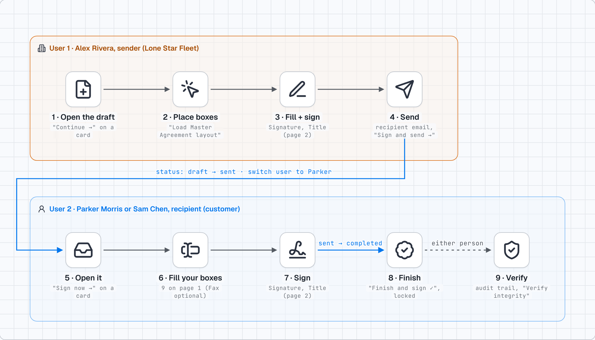
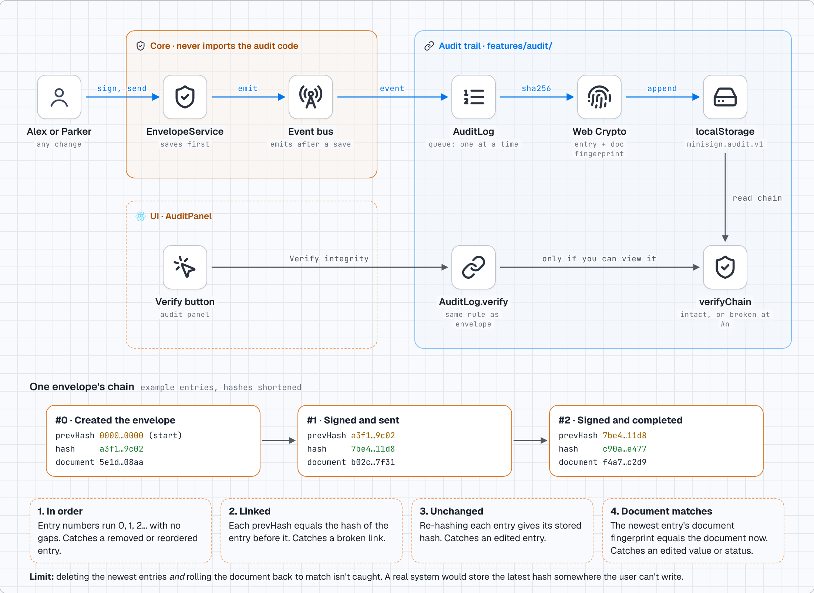

# MiniSign

A mini document-signing app (CedarBluff take-home). A sender places boxes on the Master Agreement,
fills and signs their part, and sends it. The recipient fills and signs theirs. Then the document locks.

The full reasoning and trade-offs are in **[WRITEUP.md](WRITEUP.md)**. This page is the short version.

```bash
npm install
npm run dev   # http://localhost:5173
npm test      # 32 tests
```



---

## The short version

### 1. Three separate things, not one

| What | Example | Can change? |
|---|---|---|
| **The blank document** | The 2-page Master Agreement, as page images | Never |
| **The layout** (where the boxes go) | "Signature box, page 2, here" | Only while it's a draft, only by the sender |
| **The values** (what people typed) | "Alex Rivera" | Each person, only in their own boxes, only on their turn |

Keeping layout and values apart means "lock the layout" and "edit your boxes" are two different rules.

**Status** only moves one way, **draft → sent → completed**, through one function (`transition`) that
checks the right person, the right state, and that the required boxes are valid.

### 2. Boxes stay put at any size

A box is stored as **page number + fractions of the page** (for example 14% across, 50% down), not
pixels. The page keeps its shape, and the boxes use percentages, so they line up on a wide screen or a
phone with no extra code.

### 3. One source of truth

Documents live in one place: storage, read through the service. Zustand holds only "who am I acting as".
The checklist and progress bar are calculated from the document each time, never stored, so they can't
disagree with it.

### 4. The feature: a tamper-evident audit trail



- Every change is recorded: who, what, when.
- Each entry is sealed with the **fingerprint of the entry before it**, and of what the document looked
  like at that moment.
- **Verify integrity** re-checks the whole chain and the document. Edit history or a signed value and it
  reports exactly where.
- It plugs in through an **event bus**. The core app never imports the audit code, so adding something
  like notifications later is just another listener.

### 5. Rules are enforced, not just hidden

The same rule functions decide what the screen shows **and** are checked again on every save.

- The sender and recipient can each edit only their own boxes, and only on their turn.
- Once it's sent, the layout and the sender's values are locked. Once completed, everything is.
- Required boxes must be valid (email, phone, signature) before sending or finishing.
- You only see your own documents. Opening someone else's link says "not found".

### 6. Honest limits

- There's no server, so someone with browser DevTools can still edit storage. The rules are written so
  they could run on a server unchanged.
- Verify can't catch someone deleting the newest entries *and* rolling the document back to match. A
  real system would store the latest fingerprint somewhere the user can't write.
- Typed signatures only. You can move boxes but not resize them.

---

## Try it in 2 minutes

1. As **Alex Rivera**, open the draft, click **Load Master Agreement layout**, then **Next: fill and send**.
2. Fill the yellow boxes, send to `parker@morrisfleet.example`.
3. Switch the header to **Parker Morris**, open it, fill the yellow boxes, **Finish and sign**.
4. Switch to **Dana Brooks**: there's nothing to see.
5. Click **Verify integrity** in the audit panel.

## Repo layout

| Path | What's there |
|---|---|
| `WRITEUP.md` | The write-up: decisions, trade-offs, AI use, what's unfinished |
| `CLAUDE.md` | The pre-build plan (spec), kept as written |
| `src/domain/` | Pure rules: types, status changes, permissions, validation |
| `src/service/` | Checks every rule on every call, then announces what happened |
| `src/repository/` | Storage behind an async interface |
| `src/features/audit/` | The audit trail, plugged in through the event bus |
| `src/components/` | The screens |
| `docs/` | Diagrams: architecture, audit trail, plain-language flow, both users' steps |
| `sample/master-agreement.pdf` | The original sample document |
