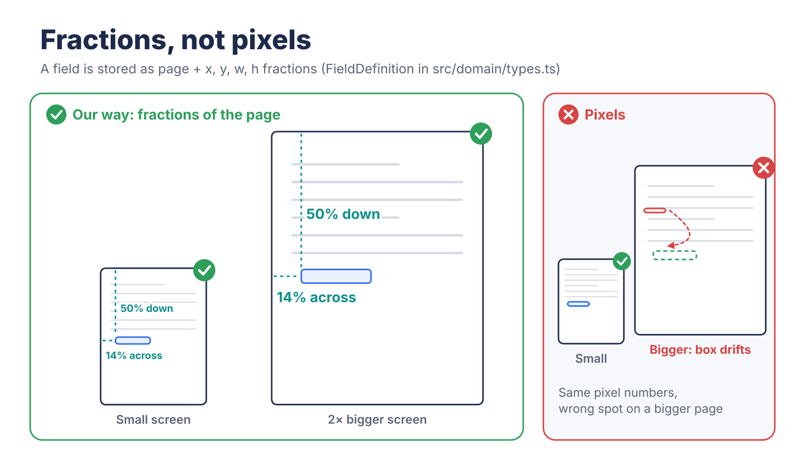
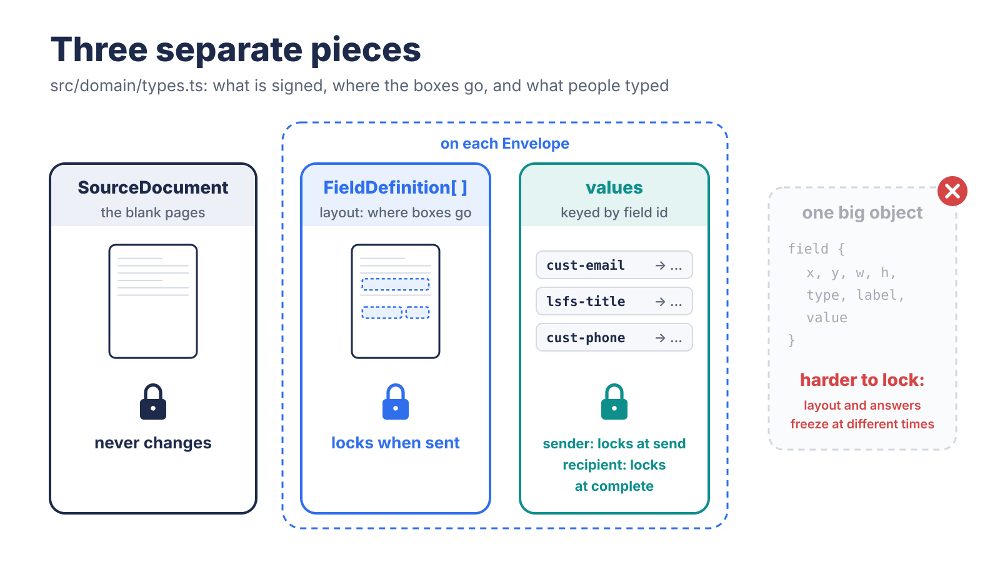
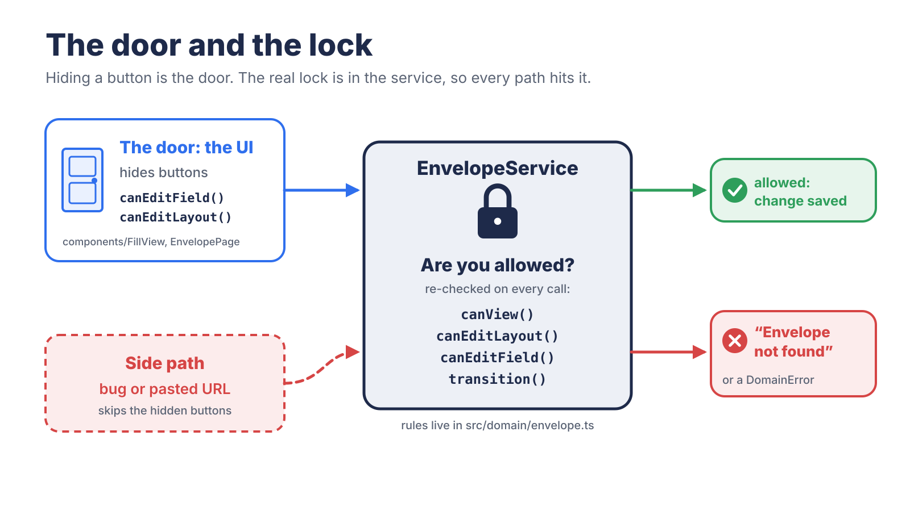
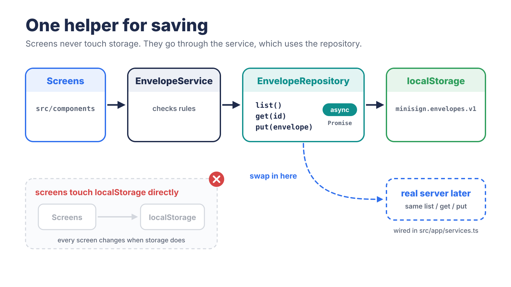
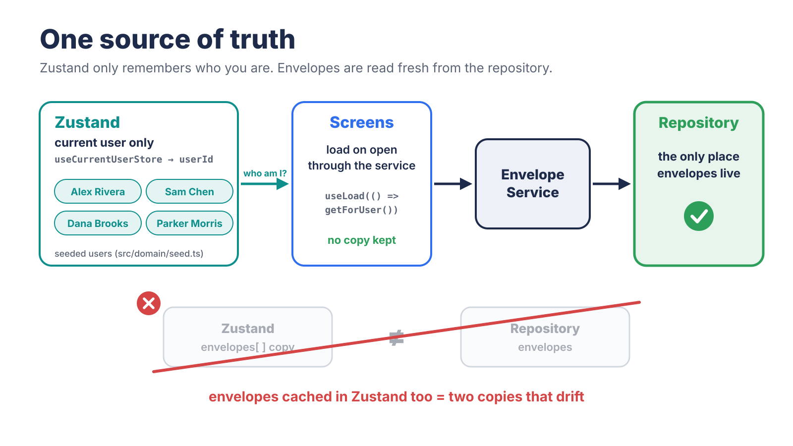
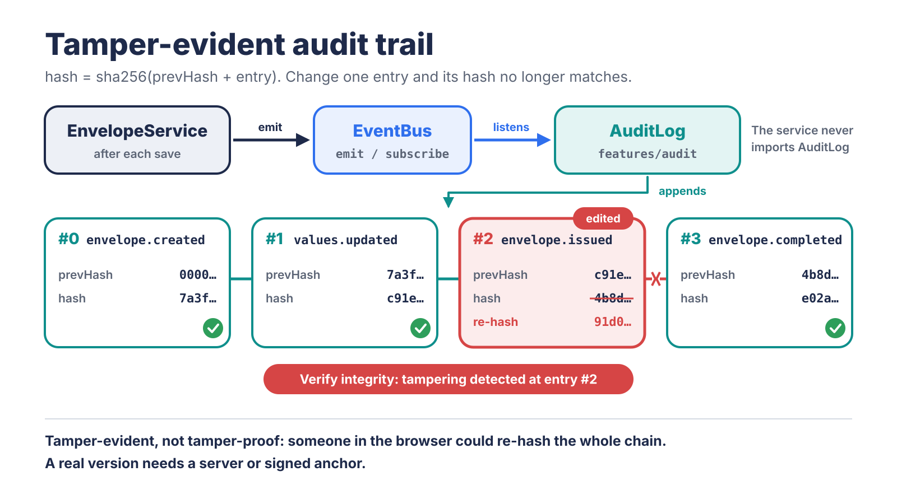

# MiniSign write-up

A small DocuSign-style app. A sender places fields on the Master Agreement, fills and signs their own fields, and issues it. The recipient fills their fields and signs. The document is then locked.

The Part 2 feature is a tamper-evident audit trail, fed by an event bus.

Build time: about 85 minutes, inside the 90-minute limit.

## 1. How to run

Tested with Node 22. Download the zip and run:

```bash
cd cedarbluff-docusign
npm install
npm run dev     # http://localhost:5173
npm test        # Vitest: domain, service, and audit tests
npm run build   # type-check + production build
```

### Libraries and why I used them

| Library | What it does here | Why I chose it |
| --- | --- | --- |
| React Router | Moves between the document list, builder, and signing screens | Each screen gets its own URL. The service still checks access, so pasting another user's document URL shows "not found." |
| Zustand | Remembers which fake user is currently selected | It is small and needs little setup. I use it only for the current user, so document data has one source of truth: the repository. |
| Vitest | Runs the project tests | It fits a Vite + TypeScript project and runs the domain, service, and audit tests. |

I did not add a PDF library, UI component kit, or drag-and-drop library. The assignment allows page images, so the Master Agreement is shown as two pre-rendered PNGs instead of rendering the PDF with pdf.js. That avoided worker and bundler setup, but the app cannot load a new PDF yet.

The screens use plain React, and dragging uses browser pointer events. Fewer libraries meant less setup during a short build and fewer things for the reviewer to install or debug.

### Walkthrough

1. You start as Alex Rivera at Lone Star Fleet Services. Open the seeded draft using "Continue."
2. Click "Load Master Agreement layout" to load 17 fields, or pick a type and click the page to place fields yourself. Drag to move a field. Click a field to edit its label, type, assignee, and required flag.
3. Go to "2. Fill, sign and send." Fill Signature and Title, enter Sam Chen / `sam@acmecorp.example`, and send.
4. Switch the header to Sam Chen, open the document, fill the customer fields, and click "Finish."
5. Switch to Dana Brooks. She sees no envelopes, and pasting the envelope URL shows "not found."
6. A fourth user, Parker Morris at the fictional Morris Fleet Co., `parker@morrisfleet.example`, can be used as a recipient instead of Sam.
7. In the audit panel, click "Verify integrity." To see tampering detected, change an entry's recorded content in `localStorage["minisign.audit.v1"]`, or change a signed value in `localStorage["minisign.envelopes.v1"]`, using DevTools. Reload and verify again without recomputing the hashes.

Data lives in `localStorage`. Clear site data to reset.

## 2. Architecture overview

```text
src/
  domain/            pure TypeScript: types, state machine, permissions,
                     validation, seed data
  service/           EnvelopeService (takes the acting user) + EventBus
  repository/        EnvelopeRepository interface + localStorage implementation,
                     source documents
  features/audit/    the Part 2 feature: hash chain + AuditLog
                     (subscribes to the bus)
  store/             Zustand: the current user only
  app/               composition root (wires concrete classes together)
                     + a small load hook
  components/        screens: list, builder, fill/sign view, page viewer,
                     audit panel
```

The domain contains the rules and imports nothing else from the app. The service coordinates those rules with persistence and events, without importing React. Components call the service rather than accessing storage directly. The composition root wires the concrete implementations together.

### Data model

The model in `src/domain/types.ts` separates three things:

| Concept | Type / contents | When it changes |
| --- | --- | --- |
| Source document: the blank document, stored as page images | `SourceDocument`: ID, title, page images, and sizes | Does not change in this app |
| Field layout: where boxes go | `FieldDefinition[]` on the envelope: page, `x/y/w/h` fractions, type, label, required flag, and assignee | Only while `draft`, and only by the sender |
| Values: what people typed | `values`, keyed by field ID, containing `FieldValue` entries | Sender values while `draft`; recipient values while `sent`; nobody's once `completed` |

An `Envelope` is one copy of a source document sent to one recipient. It contains `sourceDocId`, `senderId`, `recipient`, `status`, `fields`, `values`, and timestamps.

Status moves only through:

```text
draft → sent → completed
```

Those transitions go through one pure function, `transition(envelope, action, actor)`, in `domain/envelope.ts`. It throws a `DomainError` for the wrong state, the wrong person, or invalid required fields.

### State and data flow

Envelopes have one authoritative source: the repository, accessed through the service.

Screens load what they need through `useLoad → envelopeService.getForUser` and replace their displayed envelope with whatever the service returns after a change. Zustand holds only who I am acting as.

Form inputs keep a local edit buffer while typing and save on blur. That is temporary UI state, not a second shared document store. Screens and tabs can still become stale until they reload; the design avoids adding another independently maintained envelope cache in Zustand.

## 3. Key decisions and trade-offs

### Decision 1. Save field positions as fractions of the page

TL;DR: We save where each box goes like "14% across the page" instead of an exact pixel spot. That way the box stays in the right place when the page gets bigger or smaller.

Principle: resolution independence.



What I chose: Each field stores a page number plus `x`, `y`, `w`, and `h` as fractions from 0 to 1. For example, `x: 0.14` means 14% of the way across the page.

Why: Fixed pixel positions only line up at the page size they were measured against unless they are scaled. Fractions scale naturally with the displayed page. PDF point coordinates could also scale, but this app shows page images with CSS, so fractions are simpler here.

In a browser check, a field at `0.140 / 0.505` stayed aligned at page widths of `1072px` and `388px`.

Trade-off: A future PDF export would need to convert the fractions into the PDF's coordinate system. The model already stores each page's width and height to support that conversion.

### Decision 2. Keep the field layout separate from the values people enter

TL;DR: The map of where boxes go is kept apart from what people type in them. That makes it easier to lock the boxes and the sender's answers first, then lock the recipient's answers later.

Principle: separation of concerns.



What I chose: The layout says where each box goes. Values store what people typed, keyed by field ID. The source document is separate from both.

Why: The layout and sender values lock when the document is sent, and recipient values lock when it is completed. These rules could be built with values stored directly on the fields, but separating them makes the locks easier to enforce and test.

It also means a layout could become a reusable template without first removing anyone's answers.

Trade-off: If a field is deleted, retyped, or reassigned, the app must also remove its old value. Otherwise, the recipient could receive a box the sender had already filled.

### Decision 3. Check permissions in the service, not only in the UI

TL;DR: Hiding a button is like closing a door, but the service checks the lock. Even if someone reaches the action another way, the app still checks whether they are allowed.

Principle: defense in depth through service-layer authorization. This is not server-side security; the service still runs in the browser.



What I chose: Rules for who can view an envelope, edit a field, change the layout, issue, or complete are plain domain functions. The UI uses them to show or hide controls, and `EnvelopeService` checks the relevant rules again before applying changes.

Why: Hiding a button is not enough. The service check blocks an unauthorized action when an app code path skips the screen's controls.

Single-document reads are checked too. A forbidden document returns "not found" so the app does not reveal that it exists.

Trade-off: Everything still runs in the browser and uses `localStorage`, so someone with DevTools can edit the data. These checks protect against unauthorized paths through the app, not a determined person who controls the browser. A real backend would need to enforce authorization independently.

### Decision 4. Put localStorage behind an async repository

TL;DR: The app saves data through one helper instead of reaching straight into browser storage. Later, that helper could be replaced with a server-backed implementation without rebuilding every screen.

Principles: the repository pattern and dependency inversion.



What I chose: The rest of the app talks to the `EnvelopeRepository` contract—`list`, `get`, and `put`—instead of reading `localStorage` directly. These methods return promises even though `localStorage` is synchronous.

Why: A real signing app would eventually need a server. Because the app already handles async data, a server-backed repository could replace the localStorage implementation, with the wiring changed mainly at the composition root rather than in every screen.

That does not make the backend itself a one-file change. Authentication, authorization, concurrency, and durable storage would still need to be implemented.

Trade-off: It adds some abstraction to a small demo. Data also stays in one browser, so the sender and recipient are simulated with a user switcher. Two tabs can show different snapshots until they reload.

### Decision 5. Zustand holds only the current user

TL;DR: The repository is the authoritative place for document data. Zustand only remembers who you are pretending to be, so there is no second shared envelope cache to keep synchronized.

Principle: single source of truth.



What I chose: Zustand stores the currently selected user and nothing else. Screens load envelopes through `useLoad → envelopeService.getForUser` and replace their displayed envelope with whatever the service returns after each change.

Form inputs keep a small local buffer while typing and save on blur. That is temporary UI state, not another authoritative document store.

Why: The first spec cached envelopes in Zustand as well as in `localStorage`. That would create another copy to synchronize, for example after a save fails or another user changes the document. Claude Code flagged it, and I changed the design so the repository is the only authoritative source of envelope data.

Trade-off: Screens reload data from the service instead of reading a shared in-memory envelope cache. That means a little more loading code. It also does not solve cross-tab synchronization: two open tabs can show different snapshots until they reload.

For this app, avoiding an extra cache was more valuable than avoiding a few reads.

### Extra UI after the core flow

After the core flow worked, I added a few things that make the two-person flow easier to follow:

- A "what you need to fill in" checklist.
- A four-stage progress bar.
- Box colors from each viewer's point of view: yours to do, yours done, filled automatically, and theirs.
- A cleaner visual design.

These are presentations of existing rules, not new permissions or lifecycle states.

The checklist (`domain/checklist.ts`) and progress bar (`domain/progress.ts`) are pure domain functions built on the same `validateFields` rules that gate send and finish. Both are derived from the envelope rather than stored separately, which reduces the risk of stale or conflicting state.

A test checks that the checklist and the send/finish gate agree.

### How this maps to the evaluation

| Area | Where to look |
| --- | --- |
| Data modeling | Decision 2 and the data model table: source document, layout, and values are separate; `transition()` controls status changes |
| Field positioning | Decision 1: page index plus fractions, percentage CSS, checked at two widths |
| State and data flow | Decision 5 and Section 2: the repository is authoritative; Zustand holds only the current user; checklist and progress are derived |
| Feature | Section 4: the audit log subscribes to an event bus; the core never imports it |
| Correctness | Decision 3: domain rules run in the UI and again in the service; tests cover wrong actors, locked states, validation, and hidden envelopes |
| Communication | This document, including trade-offs and unfinished work |

## 4. Feature: audit trail on an event bus

Principles: event-driven decoupling and an append-only audit log with hash chaining. "Append-only" describes normal app behavior, not a restriction enforced against someone editing browser storage.



### What it does

The audit subscriber records change events per envelope:

- Created.
- Layout updated.
- Values updated.
- Issued.
- Completed.

Each entry includes the acting user and a client-clock timestamp. These timestamps are not independently trusted.

Each entry also stores `prevHash`, the previous entry's hash, and its own hash, using Web Crypto:

```text
hash = sha256(prevHash + canonical entry content)
```

"Verify integrity" walks the chain and checks two things:

1. Each entry's content still matches its own hash.
2. Each `prevHash` matches the entry before it.

Editing or reordering an entry, or removing one from the middle, breaks verification unless the affected hashes are recomputed.

Removing entries from the end is not detected by chain linkage alone: what remains is still a valid, shorter chain.

### Checking the document too

Each entry also seals a fingerprint of the document as it was saved: status, recipient, layout, and every value.

Verification compares the newest entry's fingerprint with the document as it is now. This flags a signed value or status edited directly in storage if the recorded fingerprint has not also been rewritten.

The audit module takes the fingerprint after the save, from the repository. The core service still does not import or depend on the audit feature.

### Why this feature

In a signing product, current status is not enough. `status` says where a document is now; the audit trail records how it got there.

The feature is small, and it exercises the architecture: it can subscribe to existing change events without making the core depend on the audit implementation.

### How it plugs in

`EnvelopeService` emits events on a small `EventBus` after each successful save. `features/audit/AuditLog` subscribes in the composition root.

The service never imports the audit code. Another feature, such as a notifications inbox, could subscribe to the same events without adding that feature's implementation to the service.

### Details that matter

- Writes are queued one at a time. Hashing is async, so two events fired back to back could otherwise read the same previous entry and fork the chain. A test fires overlapping changes and checks that the sequence stays `0, 1, 2, 3` and verifies.
- Events fire only after the save succeeds. The log does not intentionally record a change that failed to persist.
- A failing listener cannot break the core action. The trade-off is that the audit write is not transactional with the document save. If the subscriber fails after a successful save, the log can miss that event.
- Reading the trail uses the same access rule as the envelope.
- Display grouping does not change the stored log. The panel groups consecutive same-person, same-type entries, such as "Filled in fields ×12," and uses plain-English labels. Every entry is still stored and verified, and each group expands to show its entry numbers and hashes.

### Security limit

The chain is tamper-evident, not tamper-proof, and it is not secure signing evidence.

Someone who controls `localStorage` can rewrite every entry and recompute every hash. They can also delete the newest entries and roll the document back to match an older fingerprint.

Detecting those attacks requires a trusted external record of the latest hash and entry count, such as a server-held anchor or an appropriately signed record. A hash chain stored entirely in the same editable browser storage cannot provide that trust by itself.

## 5. How I used AI

### Planning

I used Perplexity Computer to take in the README from the email and create a `SPEC.md`, including notes on logic I chose myself, such as the audit trail.

I used my EGM skill—Elephant Goldfish Model—to review `SPEC.md` for gaps before handing it to Claude to build.


### Build

I used Claude Code to write the code from that `SPEC.md`.

### Where I changed what the AI gave me

Claude Code reviewed the Perplexity spec before building and found five problems. I accepted all five, listed at the bottom of `CLAUDE.md`:

1. The spec cached envelopes in Zustand as well as `localStorage`, creating another document cache to synchronize. Zustand now holds only the current user.
2. The spec only auto-filled the recipient's name and date on complete, so the sender's Print Name and Date would never be filled. They are now auto-filled on issue.
3. The spec filtered only the list by user, so typing an envelope URL would open anyone's document. Single-document reads are now checked too.
4. Async hashing could fork the audit chain, so appends are now queued.
5. React Router was missing from the stack.

### Review

I used Claude to review the grading requirements, identify gaps, and create architecture and decision diagrams.

## 6. What's unfinished

- Drawn signatures: Input is typed only. The data model already supports `{ kind: 'drawn', dataUrl }`, and the viewer renders it, but there is no canvas input.
- Field resizing: Fields use a default size per type. You can move them but not resize them.
- No "viewed" event: The audit trail records changes, not views.
- An audit write can fail after the action: The core change is saved first, then the audit log appends. If that append fails, the log can miss an entry. A real system would need transactional persistence or an outbox.
- Chatty log storage: Every field edit is stored as its own `values.updated` entry. The panel groups entries for reading, but storage is not batched.
- Seeded recipients only: Recipients must be one of the seeded users to sign. Matching is by email; there are no invitations or new accounts.
- Security is simulated: The rules run in the browser, so anyone with DevTools can edit `localStorage`. A production system would need authenticated, server-enforced rules.
- Cross-tab synchronization: Open tabs can show stale envelope snapshots until they reload.
- Test coverage: The project test suite covers the domain, service access, checklist, progress, and audit chain—32 tests. There are no component or end-to-end tests in the repo. The full flow was checked with a scripted browser run that is not committed.
- One source document: The "pick a document" step exists, but only the Master Agreement is registered.
