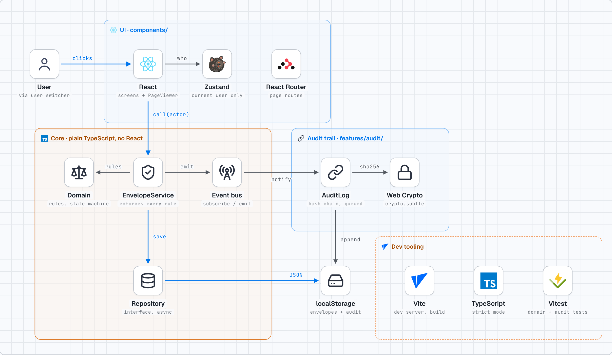

# MiniSign — Write-up

A small DocuSign-style app: a sender places fields on the Master Agreement, fills and signs
their own fields, and issues it; the recipient fills their fields and signs; the document is
then locked. Part 2 feature: a tamper-evident audit trail fed by an event bus.

## 1. How to run

Tested with Node 22.

```bash
npm install
npm run dev     # http://localhost:5173
npm test        # Vitest: domain, service and audit tests
npm run build   # type-check + production build
```

Walkthrough:
1. You start as **Alex Rivera** (Lone Star Fleet Services). Open the seeded draft (Edit).
2. Click **Load Master Agreement layout** (17 fields), or pick a type and click the page to place
   fields yourself. Drag to move; click a field to edit its label, type, assignee, required flag.
3. Go to **2. Fill, sign and send**, fill Signature and Title, enter `Sam Chen` /
   `sam@acmecorp.example`, and send.
4. Switch the header to **Sam Chen**, open the document, fill the customer fields, and Finish.
5. Switch to **Dana Brooks**: she sees nothing, and pasting the envelope URL shows "not found".
   (A fourth user, **Parker Morris** at a made-up "Morris Fleet Co.", `parker@morrisfleet.example`,
   can be used as a recipient instead of Sam.)
6. In the audit panel, click **Verify integrity**. To see tampering detected, edit any entry in
   `localStorage["minisign.audit.v1"]` in DevTools and verify again.

Data lives in `localStorage`; clear site data to reset.

## 2. Architecture overview



```
src/
  domain/            pure TypeScript: types, state machine, permissions, validation, seed data
  service/           EnvelopeService (every call takes the acting user) + EventBus
  repository/        EnvelopeRepository interface + localStorage implementation, source documents
  features/audit/    the Part 2 feature: hash chain + AuditLog (subscribes to the bus)
  store/             Zustand: the current user only
  app/               composition root (wires concrete classes together) + a small load hook
  components/        screens: list, builder, fill/sign view, page viewer, audit panel
```

Each layer only calls the one below it. `domain/` imports nothing else from the app, and
`service/` imports no React. Components never touch storage; they call the service.

**Data model** (`src/domain/types.ts`), three separate things:

| Concept | Type | Changes? |
|---|---|---|
| Source document (the blank PDF) | `SourceDocument` — id, title, page images and sizes | Never |
| Field layout (where boxes go) | `FieldDefinition[]` on the envelope — page, x/y/w/h fractions, type, label, required, assignee | Only while `draft`, only by the sender |
| Values (what people typed) | `values: Record<fieldId, FieldValue>` on the envelope | Sender's while `draft`, recipient's while `sent`, nobody's once `completed` |

An `Envelope` is one copy of a source document sent to one recipient: `sourceDocId`, `senderId`,
`recipient`, `status`, `fields`, `values`, and timestamps.

**Status** moves only `draft → sent → completed`, through one pure function,
`transition(envelope, action, actor)` in `domain/envelope.ts`. It throws a `DomainError` for the
wrong state, the wrong person, or invalid required fields.

**State and data flow.** Envelopes have one source of truth: the repository, read through the
service. Screens load what they need (`useLoad` → `envelopeService.getForUser`) and replace it with
whatever the service returns after a change. Zustand holds only "who am I acting as". Form inputs
keep a local edit buffer while typing and save on blur. That is UI state, not a second copy of the
data.

## 3. Key decisions and trade-offs

**1. Field positions are page index plus fractions of the page (0–1), not pixels.**
Each page renders in a box with the page's `aspect-ratio`, and fields use percentage
`left/top/width/height`. The same numbers work at any size, with no resize code. I checked this in a
browser: a field sat at 0.140 / 0.505 of the page at both 1072px and 388px page widths.
*Trade-off:* PDF points (612×792) would map 1:1 to a real PDF for stamping a signed copy, but they
tie the model to one unit and still need converting for display. Fractions plus the page's known size
can be converted to points later when needed.

**2. Values are stored separately from the layout.**
`FieldDefinition` has no `value`. "Lock the layout" and "edit values" are different permissions with
different timing, so they're different data. It also means the same layout could be reused as a
template later.
*Trade-off:* rendering a field means a lookup by id, and deleting a field must also drop its value
(`applyLayout` does this).

**3. Rules live in pure domain functions, and the service re-checks them on every call.**
`canView`, `canEditLayout`, `canEditField`, `transition`, and `validateFields` are used by the UI to
decide what to show *and* by `EnvelopeService` before every write. Hiding a button is never the
protection. Single reads are checked too: `getForUser` returns the same "not found" for missing and
forbidden envelopes, so ids can't be probed.
*Trade-off:* the UI computes permissions it could have been told by a server. Without a backend, the
service is the trust boundary, so a determined user with DevTools can still edit localStorage. A real
backend would run the same domain functions server-side.

**4. localStorage behind an async repository interface.**
`EnvelopeRepository` has `list/get/put`, all returning Promises even though localStorage is
synchronous, so the calling code already has the shape of an HTTP API. Swapping in a backend changes
one class in the composition root.
*Trade-off:* it's per-browser, so the two users are simulated in one browser with the user switcher.

**5. Page images instead of pdf.js.**
The two pages are pre-rendered PNGs (150 DPI). This avoided pdf.js worker setup inside the time box.
`SourceDocument.pages[].imageUrl` is the only thing the viewer needs, so swapping in pdf.js later
changes how pages are drawn and nothing above the viewer.

Smaller choices: one `/envelope/:id` route instead of separate edit and sign routes, because what you
see is derived from the permission functions. Auto-filled fields (Print Name, auto-date) are filled
by `transition()` at the moment each side signs: the sender's on issue, the recipient's on complete.
Validation skips them because they can't be missing.

Libraries: **React Router** (routes), **Zustand** (current user; tiny, no provider), **Vitest**
(tests). No PDF, UI kit, or drag-and-drop library; dragging is plain pointer events.

## 4. Feature: audit trail on an event bus

**What it does.** Every change (created, layout updated, values updated, issued, completed) is
recorded per envelope with who and when. Each entry stores `prevHash` (the previous entry's hash) and
`hash = sha256(prevHash + canonical entry content)` using Web Crypto. **Verify integrity** walks the
chain and checks both that each entry's content still matches its own hash and that each `prevHash`
matches the entry before it. Editing or reordering any entry, or removing one from the middle,
breaks the chain at that point. Removing entries from the *end* is not caught: what's left is still a
valid, shorter chain (see the honest limit below).

**Why this feature.** In a signing product, the history is the evidence. `status` only says where a
document is now, and the audit trail says how it got there. It's small, and it exercises the
architecture: it should be addable without touching the core.

**How it plugs in.** `EnvelopeService` emits events on a tiny `EventBus` after each successful save.
`features/audit/AuditLog` subscribes in the composition root. The service never imports the audit
code. A notifications inbox, for example, would be another subscriber, with no core change.

Details that matter:
- **Writes are queued one at a time.** Hashing is async, so two events fired back to back could both
  read the same "previous" entry and fork the chain. There's a test that fires overlapping changes and
  checks the sequence stays 0, 1, 2, 3 and verifies.
- **Events fire only after the save succeeds**, so the log never records a change that didn't happen.
  A failing listener is caught so it can't break the core action.
- **Reading the trail uses the same access rule as the envelope.**
- **The panel groups consecutive same-person, same-type entries** (e.g. "Filled in fields ×12") and
  uses plain-English labels. This is display only: every entry is still stored and verified, and each
  group expands to show its entry numbers and hashes.

**Honest limit.** The chain makes tampering *detectable*, not impossible: someone who controls
localStorage can rewrite every entry and recompute every hash, or simply delete the newest entries.
Both are fixed the same way: a real system would anchor the latest hash (and entry count) somewhere
the attacker can't write (a server, a signature with a private key, or the completion
email sent to both parties).

## 5. How I used AI

<!-- Parker: this section must describe only what you actually did. Read it, correct anything that
     isn't accurate, and rewrite it in your own words before submitting. -->

- **Planning (~20 minutes, before the 90-minute time box):** I used Perplexity Computer to draft the
  spec (`CLAUDE.md` in this repo): stack, data model, layers, rules, the target field coordinates
  (measured from the PDF text layer), build order, and a cut list.
- **Build:** I used Claude Code to write the code from that spec, and to explain the decisions to me as
  it went.
- **Where I changed what the AI gave me:** Claude Code reviewed the Perplexity spec before building and
  found five problems. I accepted all five (listed at the bottom of `CLAUDE.md`):
  1. The spec cached envelopes in Zustand as well as localStorage, which is two sources of truth.
     Zustand now holds only the current user.
  2. The spec only auto-filled the recipient's name and date on complete, so the sender's Print Name
     and Date would never be filled. They're now auto-filled on issue.
  3. The spec filtered only the list by user, so typing an envelope URL would open anyone's document.
     Single reads are now checked too.
  4. Async hashing could fork the audit chain, so appends are now queued.
  5. React Router was missing from the stack.
- **Testing caught a real bug:** a browser check at phone width showed the document pages collapsing to
  zero width (a flexbox setting). It's fixed in `f384f30`.
- Some of the spec's field coordinates were nudged so fields sit inside the boxes. The Title fields
  moved right so they don't cover the "Print signer's title" label.

## 6. What's unfinished

- **Drawn signatures.** Typed only. The data model already has `{ kind: 'drawn', dataUrl }` and the
  viewer renders it, but there's no canvas input.
- **Field resizing.** Fields use a default size per type. You can move them but not resize them.
- **No "viewed" event.** The audit trail records changes, not views.
- **Audit write can fail after the action.** The core change is saved first, then the audit appends.
  If the append failed, the log would be missing an entry. A real system would write both in one
  transaction (or an outbox).
- **Chatty log storage.** Every field edit is stored as its own `values.updated` entry. The panel
  groups them for reading, but storage isn't batched.
- **Recipients must be one of the seeded users to sign.** Matching is by email, and there are no
  invitations or new accounts.
- **Security is simulated.** The rules run in the browser, so anyone with DevTools can edit
  localStorage. That's acceptable for a demo without a backend, and the domain functions are ready to
  run server-side.
- **Tests cover the domain, service access, and audit chain** (14 tests). There are no component or
  end-to-end tests in the repo; the full flow was checked with a scripted browser run that isn't
  committed.
- **One source document.** The "pick a document" step exists but only the Master Agreement is
  registered.
